# Developer Guide

## Contents

- [Introduction](#introduction)
- [Setting up and testing](#setting-up-and-testing)
- [Architecture](#architecture)
  - [Main loop](#main-loop)
  - [Model component](#model-component)
  - [Error handling and persistence boundaries](#error-handling-and-persistence-boundaries)
- [Acknowledgements](#acknowledgements)
- [Design & implementation](#design--implementation)
  - [Expense management](#expense-management)
  - [Monthly budgets and warnings](#monthly-budgets-and-warnings)
  - [Shared-bill expenses](#shared-bill-expenses)
  - [Trip management and selected-trip reporting](#trip-management-and-selected-trip-reporting)
  - [Monthly statistics and comparison](#monthly-statistics-and-comparison)
  - [Manual currency conversion](#manual-currency-conversion)
  - [[Proposed] Export to CSV](#proposed-export-to-csv)
- [Maintaining the diagrams](#maintaining-the-diagrams)
- [Product scope](#product-scope)
- [User stories](#user-stories)
- [Non-functional requirements](#non-functional-requirements)
- [Glossary](#glossary)
- [Manual testing](#instructions-for-manual-testing)

## Introduction

TripJio is a budget tracker and travel app for students, operated through a
command-line interface. It records personal and shared expenses, converts foreign
purchases with rates the user enters, checks monthly budgets, and reports spending
by month and by trip. All data stays in one local text file.

This guide describes the code as it is now. It is intended for developers maintaining
parsers, commands, models and persistence. For command syntax and end-user
instructions, please see the [User Guide](UserGuide.md). Features that are planned
but not implemented are marked as *planned* in [User stories](#user-stories).

## Setting up and testing

Use JDK 25 and the checked-in Gradle wrapper from the repository root. Open PowerShell
in that directory on Windows. These commands run the app, check it, build the JAR
and run the packaged app respectively; exit an interactive run before continuing:

```powershell
.\gradlew.bat run
.\gradlew.bat test checkstyleMain checkstyleTest
.\gradlew.bat shadowJar
java -jar build/libs/tripjio.jar
```

On macOS/Linux, use `./gradlew` in place of `.\gradlew.bat`. The entry point is
`seedu.tripjio.TripJio`. Gradle uses JUnit Jupiter for tests and Checkstyle for Java
style checks. Test results are written to `build/reports/tests/test/index.html`.
The build does not currently configure JaCoCo: the test report is not a coverage report.

Tests mirror the main source packages (e.g. `model/expense/ExpenseTest` tests
`model/expense/Expense`). Commands are usually tested by calling `execute(state, ui)`
with a `Ui` built on in-memory streams. To test the whole main loop, `TripJioTest`
uses the `TripJio(String filePath, Ui ui)` constructor with fake input and a JUnit
`@TempDir` data file, so tests never touch the real `data/tripjio.txt`. Expected output
never depends on the day the tests run: tests either pass a fixed date or `Clock`, or
compute dates relative to `LocalDate.now()` (e.g. tomorrow).

The data path is `data/tripjio.txt`, relative to the process working directory.
Run manual experiments in a separate directory with a copy of the packaged JAR;
do not delete or overwrite real spending data to obtain a clean test environment.

## Architecture

The application runs synchronously in one terminal process. `TripJio` constructs
`Ui`, `Storage` and the loaded `AppState`, then repeatedly reads, parses and executes
a command. There is no web backend, account service or live exchange-rate API.

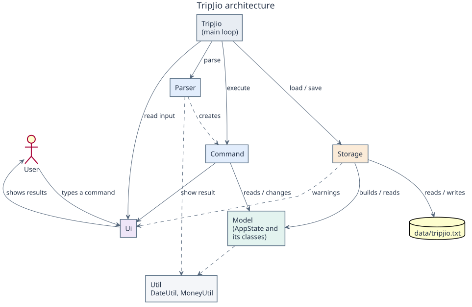

The diagram shows the main components and how they depend on each other.
`TripJio` is the only class that knows about every component: it reads input
through `Ui`, asks `Parser` for a `Command`, executes it on the shared model, and
asks `Storage` to save. Commands only see the model and `Ui`; they never call
`Storage` directly.

| Component | Main types | Responsibility |
| --- | --- | --- |
| Application | `TripJio` | Coordinate startup, command execution, warnings, saving and exit |
| Presentation | `Ui` | Read input and display command results/errors |
| Parsing | `Parser`, feature parsers, `ArgumentParser` | Validate CLI syntax and create commands |
| Commands | `Command` subclasses | Execute an operation against shared state and report its result |
| Model | `AppState`, `ExpenseList`, `Budget`, `TripBook`, `ExchangeRates` | Store and calculate domain data |
| Persistence | `Storage` and model serialisation methods | Load/save sectioned UTF-8 text |
| Utilities | `MoneyUtil`, `DateUtil` | Shared validation, rounding and formatting |

`Parser.parse` dispatches on the case-insensitive first command word. Feature
parsers handle subcommands and allowed prefixes. `Command.execute(state, ui)` is
the common polymorphic entry point. The main loop calls `getAffectedMonth()` to
decide whether to check a monthly budget and `isMutating()` to decide whether to
save. Both default to no action (`null` and `false` respectively). Only exit commands
return true from `isExit()`. The main loop also calls `Ui.showLine()` after each
command, including errors, to separate successive responses.

Commands depend on models and UI, while domain calculations do not print. Storage
is a deliberate boundary exception: `load(Ui)` reports invalid-line warnings through
the UI. The architecture does not introduce separate service interfaces or a database.

### Main loop

The sequence diagram below shows one iteration of the main loop for
`add d/Lunch a/12.50 c/food`. Other commands follow the same steps; only the
feature parser and the `Command` subclass differ. To keep the diagram small,
`Parser` is drawn as a black box (it delegates to `ExpenseCommandParser`), and the
budget check is a `ref` frame whose details are shown in the
[budget warning sequence](#monthly-budgets-and-warnings).

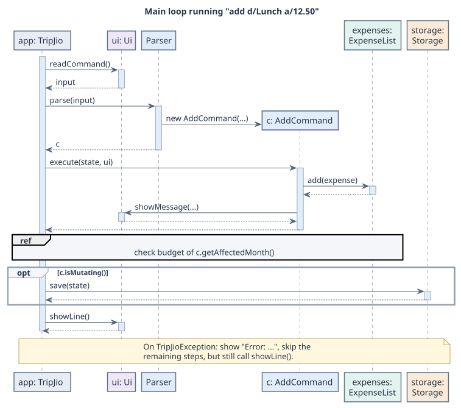

1. `Ui.readCommand()` returns the trimmed input line. At the end of input it returns
   `exit`, so the loop always terminates.
2. `Parser.parse` reads only the command word and hands the rest to the feature
   parser (`ExpenseCommandParser` here). The feature parser validates every field and
   creates the command, so an invalid command never reaches execution.
3. `execute(state, ui)` changes the model and prints the result through `Ui`.
4. The loop then asks the command three questions: `getAffectedMonth()` (check that
   month's budget), `isMutating()` (save the file) and `isExit()` (stop the loop).
   Commands therefore do not need to know about budgets or storage.
5. `Ui.showLine()` prints a separator after every command, including failed ones,
   so that successive responses are easy to tell apart.

Adding a new command only requires a `Command` subclass, a feature parser (or a new
case in an existing one) and one `case` line in `Parser`. The main loop does not change.

### Model component

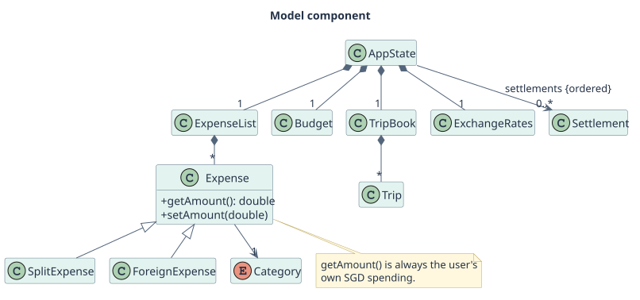

The diagram shows only classes and their relationships; fields and most methods
are left out and are described in the feature sections below. `AppState` holds one
instance of each model class, and every command works on this shared state. `ExpenseList` stores all expenses in insertion order; its indexes
are one-based to match what users see in `list`.

`Expense` has two subclasses. `SplitExpense` stores the full bill and the number of
people. Its inherited amount holds the full SGD bill, while overridden
`getAmount()` returns the user's share. `ForeignExpense` stores
the original amount, currency and rate, and keeps the converted SGD value in the
inherited amount. Because of this, budgets, trip reports, sorting and statistics
only call `getAmount()` and never need to check which kind of expense they have.
Each subclass overrides `setAmount`, `toString` and `toStorageString` for the
behaviour that is different.

`Budget`, `TripBook` and `ExchangeRates` each convert their own data to and from
lines of the data file (`toStorageLines` / `loadStorageLine`). `Storage` only splits
the file into blocks and passes each line to the right model class, so adding data
to one feature does not require changes in the others.

### Error handling and persistence boundaries

Expected input/domain errors use checked `TripJioException`. The main loop displays
the message and continues. Parsing failures occur before execution; model validation
should precede mutation. Constructors that rely on parser validation are not a
substitute for validating user input at the parser or storage boundary.

After a successful mutating command, `Storage.save` rewrites the full file. It is
not an atomic temporary-file replacement and there is no automatic backup or rollback.
A save failure does not reverse an in-memory mutation. A missing data file starts
an empty state; an unreadable file reports an error and also starts empty. Invalid
records are skipped with warnings. Back up and investigate damaged files before
issuing further mutating commands, which could overwrite recoverable records.

## Acknowledgements

The implementation-section organisation is adapted from the
[AB-3 Developer Guide example](https://se-education.org/addressbook-level3/DeveloperGuide.html#proposed-undoredo-feature).
Diagrams are authored in PlantUML and stored with their rendered SVGs. The project
uses Gradle, JUnit Jupiter, Checkstyle and the Shadow Gradle plugin as declared in
`build.gradle`. Contributors should add attribution here when introducing other
reused code, assets or documentation.

## Design & implementation

Each enhancement below describes its implementation, an example scenario, and the
trade-offs behind the design. Diagrams deliberately omit routine getters and utility
calls when they do not help explain the behaviour. Method parameters shown as `...`
are omitted for readability; notes identify other simplifications.

### Expense management

This section covers `add`, `list`, `edit` and `delete`, and `ArgumentParser`, the
shared prefix parser that every feature parser uses.

#### Implementation

**Reading prefixes with `ArgumentParser`.** A feature parser passes the text after
the command word to `new ArgumentParser(args)`. The constructor finds every known
prefix (`d/`, `a/`, `c/`, `dt/`, `m/`, `cur/`, `sort/`, `trip/`, ...) with one regular
expression. A prefix only counts when it is at the start or after a space, and its
value is all the text up to the next prefix, trimmed. Text before the first prefix is
the *preamble*, which holds an `INDEX` or a sub-command word. For example,
`edit 3 d/Lunch at cafe a/12.50` gives the preamble `3`, `d` → `Lunch at cafe` and
`a` → `12.50`. Because descriptions may not contain `/`, a value can never be
mistaken for a prefix.

The parser then asks for exactly what the command needs:

- `getRequired(p)` / `getOptional(p)` return a value, and reject a prefix that is
  empty or given twice. `getRequired` also rejects a missing prefix.
- `checkAllowedPrefixes(...)` rejects any prefix the command does not use, so a typo
  such as `add d/Lunch a/5 s/01-10-2026` fails instead of being silently ignored.
- `getFlag("trip")` reads a prefix that must have no value.
- Static helpers (`parseAmount`, `parseIndex`, `parseDescription`) and
  `DateUtil` / `MoneyUtil` check the format of each value.

The parser checks input syntax before constructing commands. State-dependent rules
and subtype invariants are also validated in models/commands; split edits, for
example, must combine a proposed bill/share with retained state before mutation.

**Adding.** `ExpenseCommandParser.parseAdd` uses `other` when `c/` is missing and
today's date when `dt/` is missing, and rejects a future date. Without `cur/` it
creates an `AddCommand` that already holds the new `Expense`; `execute` appends it to
the shared `ExpenseList`. With `cur/` it creates an `AddForeignExpenseCommand`
instead, which looks up the rate when it executes, so a missing rate is reported
without adding anything. Both return the expense's month from `getAffectedMonth()`,
which makes the main loop check that month's budget.

**Listing.** `ListCommand` never copies or reorders the stored list. It collects the
positions of the matching expenses (filters from `ExpenseFilter`), sorts those
positions if `sort/` is given, and prints each expense with its position plus one.
The printed number is therefore always the global index that `edit` and `delete`
accept, even in a filtered or sorted view. Java's list sort is stable, so equal
amounts or dates stay in the order they were added.

**Editing.** The parser leaves every field that is not given as `null`, meaning
"keep the current value". The sequence diagram shows how `EditCommand` applies them.

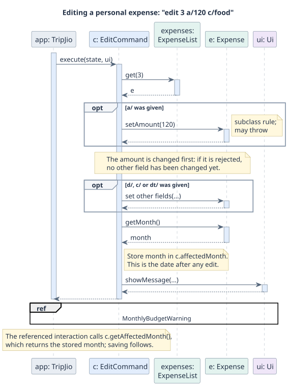

For ordinary and foreign personal expenses, amount edits dispatch through
`setAmount`, as illustrated above. Split edits instead combine the proposed bill
and custom share, then call `SplitExpense.updateAmounts` before changing any other
field. `my/` on a non-split is rejected before amount mutation. Both paths validate
before changing state, so invalid edits leave the record unchanged. The shared-bill
section below explains the split-specific path and currency units.
After the edit, `getAffectedMonth()` returns the expense's final month. If the date
moved the expense out of a month, that month's spending went down, so it does not
need a new warning.

**Deleting.** `DeleteCommand` removes the expense at the index and prints it.
Later expenses move up by one index, so the user should run `list` again before
the next `edit` or `delete`.

#### Example scenario

1. `add d/Lunch a/12 c/food dt/01-10-2026` creates an `AddCommand` holding a new
   `Expense`. The main loop executes it, checks October's budget and saves.
2. `split d/Dinner a/90 n/3 c/food dt/02-10-2026` adds a `SplitExpense` (share $30)
   as expense 2.
3. `list sort/amount` prints expense 2 before expense 1, with their original numbers.
4. `edit 2 a/120` calls `updateAmounts` with 120 and the retained custom-share
   setting. It treats 120 as the
   new full bill, so the user's share becomes $40. The object is changed in place,
   so it stays a split expense.
5. `edit 2 a/10 dt/05-10-2026` fails if the dinner had a custom share above $10.
   The date is not changed either, because the amount is applied first.

#### Design considerations

Aspect: How command arguments are read.

- Alternative 1 (current choice): One shared `ArgumentParser` that splits the input by
  known prefixes.
  - Pros: Prefixes can be given in any order; repeated, empty and unexpected prefixes
    are handled the same way in every command.
  - Cons: A new prefix must be added to the shared pattern, which affects all parsers
    and needs regression tests.
- Alternative 2: Each parser splits the input by spaces and reads fixed positions.
  - Pros: Very simple for short commands.
  - Cons: Fixed order; descriptions with spaces need quoting; error handling would
    differ between features.

Aspect: How `list` shows numbers for filtered or sorted results.

- Alternative 1 (current choice): Show each expense's global index.
  - Pros: The number can be used directly with `edit` and `delete`; the stored order
    never changes.
  - Cons: Numbers in a filtered list have gaps, and they change after a deletion.
- Alternative 2: Number the shown results 1, 2, 3, ... and remember the last view.
  - Pros: Shorter, continuous numbers.
  - Cons: `edit` would depend on which `list` ran last, which is easy to get wrong.

Aspect: Where the rules for editing different expense types live.

- Alternative 1 (current choice): Subtypes own validation, with an explicit atomic split-edit path.
  - Pros: Ordinary/foreign edits use dynamic dispatch; split bill/share changes are validated together in the model.
  - Cons: `a/` means different things for different types (SGD amount, full bill,
    original currency), which the User Guide must explain.
- Alternative 2: Put all subtype validation inside `EditCommand`.
  - Pros: All edit rules are visible in one place.
  - Cons: Every new expense type requires changing the command, and the rules would
    be separated from the data they protect.

#### Tests

`ArgumentParserTest` and `ExpenseCommandParserTest` cover prefix handling and
invalid input. `ExpenseCommandsTest` and `TravelFeaturesTest` cover the four commands,
including split and foreign expenses. `ExpenseTest` and `ExpenseListTest` cover the
model, the storage format and one-based indexes. `TripJioTest` runs the whole main
loop to check saving, budget warnings and the separator line.

### Monthly budgets and warnings

#### Implementation

`Budget` stores an optional default monthly amount and a `TreeMap<YearMonth, Double>`
of overrides. `getBudgetFor(month)` returns a month's override first, then the
default, or null when neither exists. Null represents an unset budget, not zero.
Both setters validate through `MoneyUtil`. Sorted override keys make saved data
predictable and readable.

`SetBudgetCommand` changes either the default or one override and requests saving.
It does not override `getAffectedMonth()`, so changing a budget does not automatically
trigger the main loop's warning check. `BudgetStatusCommand` reads the applicable
budget and sums expenses in the requested month. It displays spending and either
remaining funds or the amount exceeded. For the current month only, it also displays
days remaining (including today) and a nonnegative daily allowance. A constructor
accepting an explicit reference date makes those tests reproducible.

After expense-producing commands, `TripJio` calls `BudgetChecker.check` with the
affected month and monthly total. The checker returns text rather than printing.
Spending strictly above the budget produces an exceeded warning. Otherwise,
spending at or above the cent-rounded 80% threshold produces a near-budget warning.
Exactly 100% therefore takes the threshold-warning branch, not the exceeded branch.
No budget or spending below the threshold returns null. Warnings inform users;
they do not reject the expense or prevent saving.

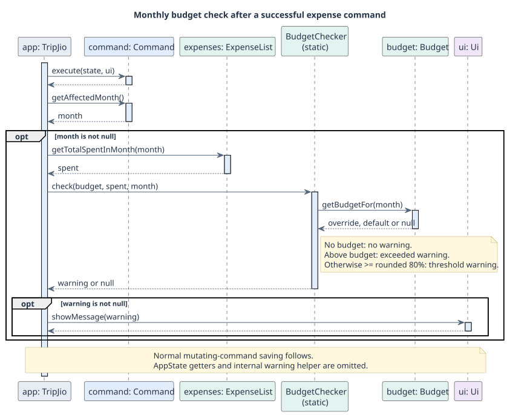

#### Example scenario

1. Set `budget set a/1000` and `budget set a/100 m/10-2026`.
2. Add an October expense of $80. October's override is used and the 80% warning appears.
3. Add another October expense of $21. Spending is $101, so the exceeded warning appears.
4. Run `budget status m/10-2026` to inspect the result. Other months still use $1000.

#### Design considerations

Aspect: Configuring monthly budgets.

- Alternative 1 (current choice): Default with monthly overrides.
  - Pros: Avoids repeated setup while accommodating unusual months.
  - Cons: Does not represent trip or category allocations.
- Alternative 2: Explicit budgets for every month.
  - Pros: Each configured month has its own amount.
  - Cons: Repetitive setup can leave months unconfigured.

Aspect: Triggering warnings.

- Alternative 1 (current choice): Central post-execution checks.
  - Pros: Add/edit/split share one policy.
  - Cons: Commands must return the correct affected month or checks are skipped.
- Alternative 2: Each command generates its own warning.
  - Pros: Command-specific behaviour is straightforward.
  - Cons: Duplicates thresholds and couples commands to budget policy.

`BudgetTest`, `BudgetCheckerTest`, `SetBudgetCommandTest` and `BudgetStatusCommandTest`
cover overrides, thresholds, missing budgets and date-dependent allowance calculations.
Trip-specific budgets and forecasting remain planned extensions.

### Shared-bill expenses

#### Implementation and model contract

**Feature owner: John Alday.** Split creation, personal-share edits, debt queries
and settlements operate on the same AppState used by budgets and trip reports.
`SplitCommandParser` validates required description/amount/people, optional
category/date/share, participant names and currency arguments. Category defaults
to OTHER, date to today; future expense dates and unsupported prefixes are rejected.

`SplitCommand.execute` constructs a SplitExpense and appends it to ExpenseList.
It returns true from `isMutating()` and `YearMonth.from(date)` from
`getAffectedMonth()`: the main loop checks that month's budget after a successful
split and saves. Failed commands do neither. Only the user's SGD share counts
towards spending; a full group bill is never added again as a separate expense.

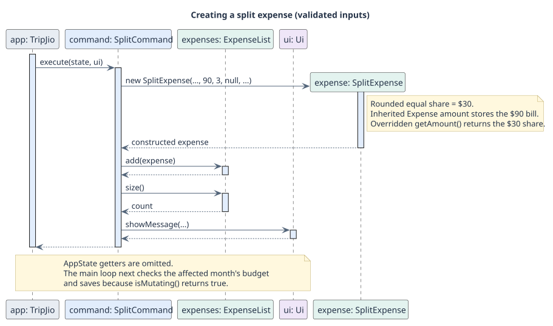

SplitExpense extends Expense. Its inherited amount holds the full SGD bill;
`getTotalAmount()` reads that value via the superclass, while overridden
`getAmount()` returns `getMyShare()`. A null customShare selects an equal share
rounded to cents; a non-null customShare stays fixed until explicitly edited.
Consumers sum polymorphic getAmount(), so budgets, sorting and trip/category
reports do not inspect private split fields.

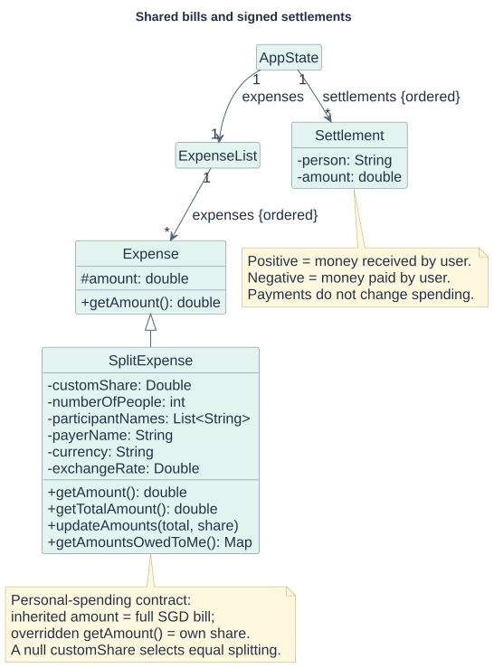

The diagram omits unrelated state and routine getters. Settlement is stored
separately from expenses: a repayment changes the ledger, not personal spending.
Public construction relies on parser/storage boundary validation; constructor
assertions are not a substitute for validating external input.

#### Named splits and exact cent allocation

`Parser` routes `owe` and `settle` to `ExpenseCommandParser`; creation remains in
`SplitCommandParser`. `ArgumentParser` recognises `p/`, `paid/` and `rate/`, and each
feature parser explicitly permits its own prefixes. Missing, empty or repeated
required/optional values are rejected before constructing commands.

`p/Alice,Bob` contains the other `n - 1` people, excluding the user. Names are
trimmed and lowercased with `Locale.ROOT`, must be unique ignoring case, and cannot
contain comma, slash, pipe or line breaks. A supplied `paid/NAME` must occur in
that participant list. Unnamed splits continue to record spending but assign no
individual debts.

Without `paid/`, the user paid the bill and each named person owes their allocated
part. With `paid/Alice`, only the user's own share owed to Alice is tracked; the
application does not model debts between other people. `getAmountsOwedToMe()`
returns an insertion-ordered map so leftover cents follow the participant order.
The essential allocation, expressed as pseudocode, is:

```text
remainingCents = round((fullSgdBill - mySgdShare) * 100)
baseCents = remainingCents / numberOfOtherPeople       (integer division)
extraCents = remainingCents % numberOfOtherPeople
person[i] receives baseCents + 1 when i < extraCents, otherwise baseCents
```

For `split d/Dinner a/100 n/3 p/Alice,Bob`, own share is $33.33, Alice owes $33.34,
and Bob owes $33.33. The three shares sum to $100.00. Allocation order is distinct
from ledger display order: `owe` uses a `TreeSet` to show names alphabetically.
`MoneyUtil.format` provides fixed-locale cents and thousands separators in both
debt directions, e.g. `$1,234.50`.

#### Debt calculation and settlement execution

`OweCommand` and `SettleCommand.calculateNetBalance` derive the person's balance
from current splits and prior payments rather than maintain a mutable debt cache:

```text
net(person) = incoming split shares - outgoing own shares - signed settlements
```

A positive net means the person owes the user; a negative net means the user owes
them. Positive stored settlement amounts represent money received by the user;
negative amounts represent money paid. Half-cent tolerances are used when testing
whether a balance is effectively settled. The optional `owe p/NAME` filters net
output; it does not currently list individual contributing splits.

For a successful `settle p/Alice a/10`, the command recomputes the balance before
recording the payment. Without `a/`, it uses the full absolute balance. A supplied
payment must be positive, finite, cent-precision and within the outstanding
balance; a zero balance or excessive payment throws `TripJioException` before an
append. The sign comes from the balance, not from user-supplied signed input.

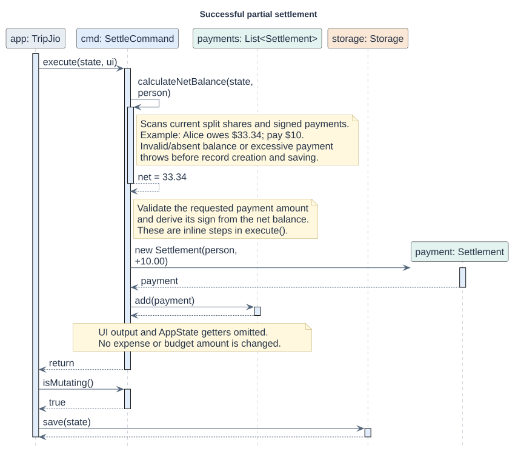

The sequence shows a successful partial payment. UI printing and AppState getters
are omitted. The calculation self-call scans applicable split shares and signed
payments as described above. On rejected input, execution stops before the new
Settlement is created and the main loop does not save that command.

Settlement does not change expenses, budgets or category/trip totals. Editing or
deleting a historical split recalculates its debt contribution while retaining
old payments, so the net can reverse direction. There is no payment-edit or undo
command. This is a boundary that maintainers must preserve and explain.

#### Atomic custom-share edits and currency units

`EditCommand` rejects `my/` on an ordinary/foreign personal expense before changing
its amount. For a split, it combines the supplied bill/share with retained values
and calls `updateAmounts`. That method validates the final pair before assigning
either field. An excerpt from the implementation's model shows the mutation boundary:

```java
validateShare(total, numberOfPeople, share);
MoneyUtil.validateOriginalAmount(total);
amount = total;
customShare = share;
```

`edit 1 a/30 my/10` can therefore replace an old $90 bill with a $40 custom share:
the new pair is valid even though the old share exceeded the new bill. Conversely,
`edit 1 a/30 d/Changed` fails with the old custom share and leaves all fields
unchanged. Equal splits recompute their share; a custom share stays fixed unless
explicitly edited. The user's share must be at least $0.01 and no more than the
full bill; the participant count remains 2 through 50.

Foreign split creation requires both `cur/CURRENCY` and an explicit `rate/RATE`,
measured in SGD per original unit. It does not look up the configured personal-
expense rate table. Rate and currency validation reuse `ExchangeRates` helpers;
conversion uses `ExchangeRates.toSgd(double, double)` and cent rounding. Validation
checks the converted SGD bill cap, not an arbitrary cap on the original number.

| Input/operation in the split implementation | Unit and behaviour |
| --- | --- |
| Creation `a/100 cur/EUR rate/1.45` | Original bill EUR 100 becomes SGD 145 |
| Creation/edit `my/45` | Own share SGD 45, not EUR 45 |
| Split `edit INDEX a/150` | Replacement full bill SGD 150, retaining saved metadata |
| Personal `ForeignExpense` amount edit | Original currency, using its saved BigDecimal rate |
| Split storage/load | Bill/share already SGD; never reconvert |

These are the current semantics, which differ from the early v2 planning notes.
`ForeignExpense` uses BigDecimal half-up conversion; the split helper uses doubles
and Math.round. Unifying those conversions and foreign-edit conventions is a
future design decision, not an implemented currency-value abstraction.

#### Split persistence and migration

The format keeps the first seven fields in their legacy order and appends payer,
comma-separated participants, currency, rate and a custom-share boolean:

```text
S|description|sgdBill|people|sgdShare|category|date|payer|participants|currency|rate|hasCustomShare
S|Dinner|100.00|3|33.33|FOOD|01-10-2026||alice,bob|||false
```

The loader accepts exactly seven or twelve fields. Old lines infer custom status
as before; new lines preserve an explicit custom share even when numerically equal
to the equal share. Empty trailing fields are retained during splitting. Currency
rates are written in plain decimal notation. Signed `[owe]` amounts use
`MoneyUtil.toStorageString` so payment records consistently contain two decimals.

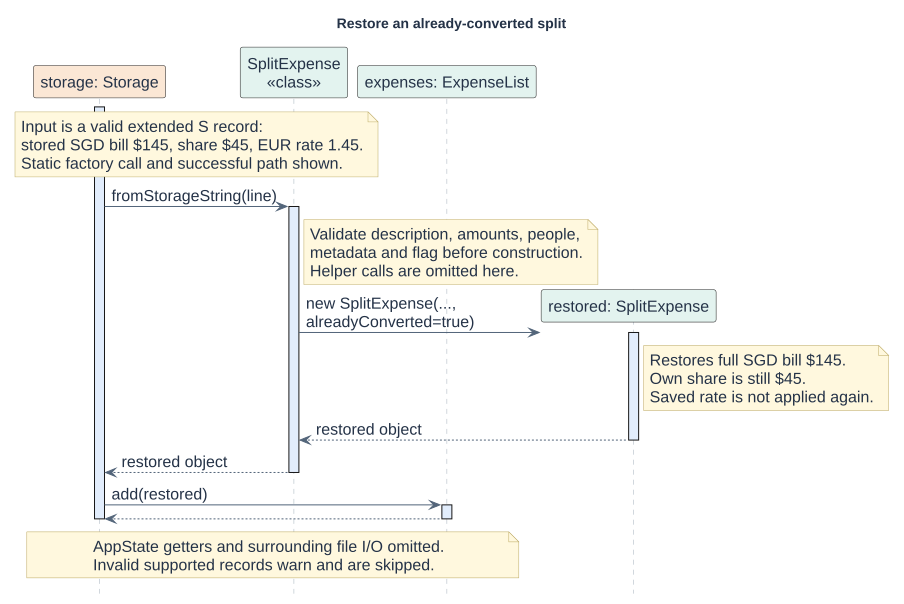

The static loader validates persisted descriptions inside the model, without an
ArgumentParser import, then restores the already-converted bill. The private
constructor's `alreadyConverted` path prevents the saved rate being applied again.
The surrounding Storage loader skips invalid supported records with a warning;
valid records continue loading. Older versions cannot load the extended format, so keep a backup before downgrading.

#### Design considerations and verification

Aspect: Computing debt after expense edits.

- Alternative 1 (current choice): Recompute from splits and signed payments on each query.
  - Pros: No cached balances to synchronize after bill/share edits.
  - Cons: Linear scans, and aggregation is currently duplicated by owe and settle.
- Alternative 2: Store a separate mutable balance per person.
  - Pros: Faster queries over a large history.
  - Cons: Every edit/delete must correctly reverse prior effects; stale balances are harder to diagnose.

Aspect: Preserving split intent and currency history.

- Alternative 1 (current choice): Extend the S record, persist the flag and store converted SGD totals.
  - Pros: Old records load and saved foreign splits are not converted twice.
  - Cons: The flag cannot recover intent missing from old records; split metadata does not retain a separately editable original bill.
- Alternative 2: New versioned currency-value records for all expenses.
  - Pros: Could unify rounding and edit units across personal and split expenses.
  - Cons: Requires a broader migration and team-wide agreement on semantics.

The implementation's `ReviewFeedbackTest` covers cent allocation, legacy/extended round-trips,
foreign metadata, both settlement directions, partial/full payments and rejected
combined edits. `OweCommandTest` checks alphabetical order, large amounts and a
German default locale. `SplitExpenseTest` checks legacy/extended description
validation; `TripJioTest` exercises actual save/restart/settle input loops. These
tests exercise the shared application workflow rather than a separate ledger-only state.

`SplitCommandTest` protects the affected-month contract. Full-loop tests in
`TripJioTest` verify threshold/exceeded warnings from ordinary and converted
splits, and confirm that a small custom share does not warn based on the full bill.

### Trip management and selected-trip reporting

#### Implementation

Trip management is facilitated by `TripBook`, which stores parallel lists of names
and `Trip` objects and an optional selected index. Commands extend `Command` and
access the same model through `AppState`; they do not maintain separate trip data.
The following partial class diagram shows the model relationships relevant to these features.
Unrelated budget and exchange-rate configuration classes are omitted for clarity.

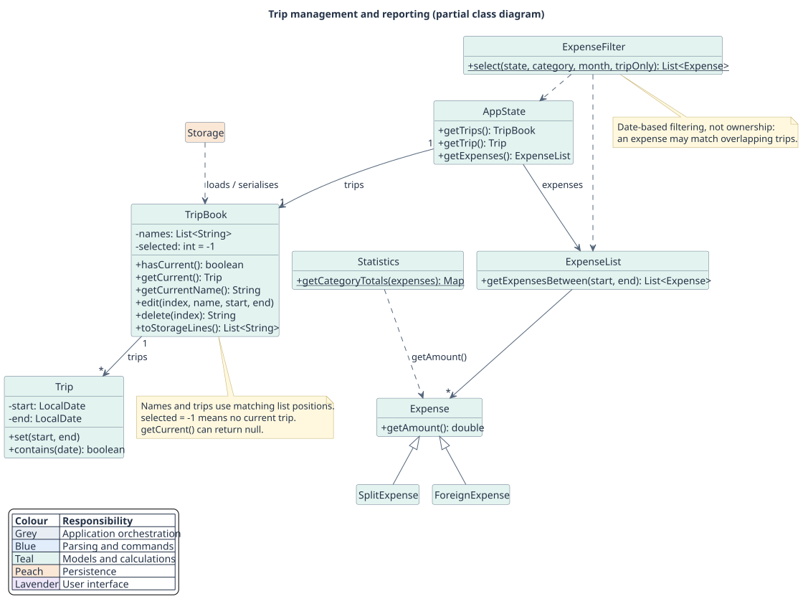

The principal operations are:

- `TripBook#edit(index, name, start, end)` — validates and applies supplied fields;
  omitted fields retain their existing values.
- `TripBook#delete(index)` — removes a trip and adjusts or clears the selection,
  without deleting expenses.
- `TripBook#hasCurrent()` / `getCurrent()` — guard and retrieve the optional selection.
- `TripBook#toStorageLines()` / `loadStorageLine(line)` — serialise and restore named trips.
- `ExpenseFilter#select(state, category, month, tripOnly)` — returns the intersection
  of the supplied filters in a fresh list, using the selected trip at execution time.
- `Statistics#getCategoryTotals(expenses)` — totals filtered expenses by category in SGD.

##### Validation and report integration

`TripCommandParser` validates the index, allowed prefixes, duplicate/empty values
and date syntax for `trip edit` and `trip delete`. Separate commands extend
`Command`, delegate mutation to `TripBook`, and print through `Ui`.
Both return true from `isMutating()` for automatic saving. They leave
`getAffectedMonth()` null because neither changes expense spending.

`TripBook.edit` validates the name against every other trip and validates the
combined old/new dates through `Trip.set` before renaming. The same Trip object,
selection and omitted fields are preserved. Failure changes nothing.
`TripBook.delete` removes the matching name/trip pair: deleting the selected
position sets selection to -1; deleting a preceding position decrements selection.
Deleting after it leaves selection unchanged. No expenses or budgets are removed.

`ArgumentParser.getFlag("trip")` handles the valueless flag without relaxing
validation of ordinary required/optional values. Only list, stats and split list
allow it; comparisons and mutating commands reject it.

`ExpenseList.getExpensesBetween(start, end)` returns a fresh insertion-ordered
list including both endpoints; invalid/null ranges throw IllegalArgumentException.
`ExpenseFilter.select(state, category, month, tripOnly)` is the shared filtering
entry point for commands and future export. It validates selection before returning
results, resolves it at execution time, and intersects trip dates/month/category.
The returned list is independent, but contains the original Expense objects.

List and split list retain indexes from the global expense collection rather than
renumbering filtered results. TripStatsCommand is read-only and uses
`Statistics.getCategoryTotals(filteredExpenses)`, which also backs monthly totals,
so foreign amounts and split shares continue through polymorphic getAmount().
The existing StatsCommand clock-based default and StatsCompareCommand are unchanged.

##### Date configuration and lifecycle

`setCurrentDates(start, end)` creates `Original trip` only when the book is empty.
Otherwise it updates the explicitly selected trip, or rejects the command when
selection is absent. `getCurrent()`, `getCurrentName()` and `AppState.getTrip()` can
return null, so callers must guard them with `hasCurrent()`.

`TripStatusCommand` is read-only. It combines `Trip` lifecycle calculations with
`ExpenseList.getTotalSpentBetween`. Inclusive duration is the number of days between
the endpoints plus one. Remaining days equal the duration before departure, include
today during the trip, and are zero after completion. Status is Upcoming, Ongoing
or Completed. An injected `Clock` keeps command tests deterministic; the model
receives an explicit reference date. `Trip.contains(date)` returns false for null
dates or unset trips, otherwise checks the inclusive bounds.

#### Example scenario

##### Editing and deleting trips

Step 1. The user adds Japan for 01–14 December 2026 and Korea for 20–25 December
2026. The book contains `[Japan, Korea]`; Korea is selected (`selected = 1`).
Displayed trip indexes are one-based; the internal selected index is zero-based.

Step 2. The user runs `trip edit 1 n/Japan e/15-12-2026`. The parser checks the
arguments and constructs `TripEditCommand`. `TripBook.edit` checks the index and
name, then asks `Trip.set` to validate the combined date range before updating it.
The Japan trip retains its object identity and start date; Korea remains selected.
The main loop saves the successful mutation. The sequence is shown below.

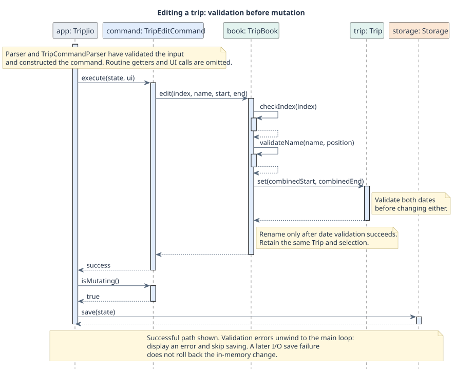

Step 3. The user runs `trip delete 1`. Japan is removed and Korea becomes the first
trip. Its selected index changes from 1 to 0, so the same trip remains selected.

Step 4. The user runs `trip delete 1` again. Korea is removed and `selected` becomes
-1. Saving writes an empty `[trips]` section with no selection record. Restarting
does not resurrect either trip. Expenses remain available to unfiltered reports.
The following object snapshots show the selection before and after each deletion;
arrows between snapshots indicate progression, not object associations.

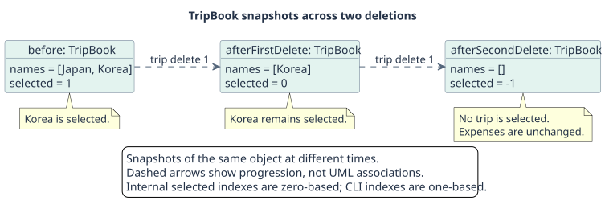

> A parsing or model-validation failure displays an error and skips saving.
> An I/O failure during saving is different: the model has already changed in memory.
> There is no undo/redo feature or transactional rollback of a failed save.

##### Selected-trip reporting

Step 1. In a separate scenario, the user adds/selects Japan for 01–15 October 2026
and records expenses before, during and after those dates. Use past expense dates
when reproducing this scenario; future expenses are rejected.

Step 2. The user runs `stats trip/`. `StatsCommandParser` creates a
`TripStatsCommand` with no month restriction. The command asks `ExpenseFilter`
for expenses within the selected trip, including both boundary dates.

Step 3. `Statistics` sums each expense's polymorphic `getAmount()`: a split
contributes the user's share, and a foreign expense contributes its SGD value.
The command prints category totals and total spending without saving or mutating data.

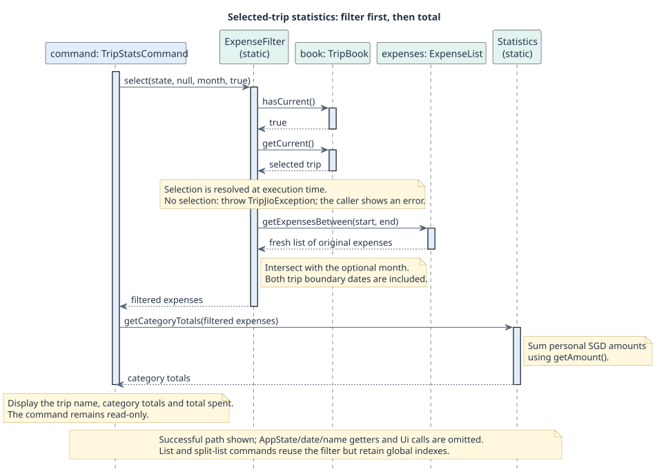

Step 4. Adding `m/10-2026` intersects the trip range with October. `list trip/`
and `split list trip/` reuse the same filter; list commands retain original expense
indexes, including after sorting, so subsequent edit/delete commands target the
same global entries. An empty intersection is a valid empty report, whereas no
selected trip produces an error before report output.

##### Storage compatibility

On loading, `Storage` checks for a `[trips]` header before interpreting legacy data.
If present, named-trip records are used and `[trip]` is ignored, even when the named
section is empty. Otherwise, a complete valid legacy trip becomes `Original trip`.
Selection records are applied after trip records. Saving writes only `[trips]`,
with `T|NAME|START|END` records and an optional `A|NAME` selection record.
No selection record means no selection. An invalid selection reference warns and
clears selection. Names rather than indexes identify the persisted selection, so
skipped malformed trip records do not accidentally select a different trip.
A legacy incomplete pair is not imported; a reversed pair is cleared with a warning.
This prevents an old copy of a selected trip from restoring a deleted trip.

#### Design considerations

Aspect: How trips relate to expenses.

- Alternative 1 (current choice): Filter by the selected trip's inclusive dates.
  - Pros: Reuses existing expense data without changing expense storage; overlapping
    trips can report the same expense.
  - Cons: Expenses cannot be assigned exclusively to one trip; editing trip dates
    changes which expenses appear in its reports.
- Alternative 2: Store a trip identifier on each expense.
  - Pros: Supports explicit attribution even when dates overlap.
  - Cons: Requires expense migration and additional rules when a trip is deleted.

Aspect: What happens when the selected trip is deleted.

- Alternative 1 (current choice): Clear selection and require explicit selection.
  - Pros: Avoids silently reporting spending for a different trip or restoring a deleted one.
  - Cons: The user must select or add a trip before using trip-specific reports.
- Alternative 2: Automatically select another remaining trip.
  - Pros: Reduces the number of follow-up commands.
  - Cons: Subsequent reports may refer to a trip the user did not intend.

Aspect: Where filtering is implemented.

- Alternative 1 (current choice): Share `ExpenseFilter` across report commands.
  - Pros: Keeps date boundaries and missing-selection errors consistent; reusable by export.
  - Cons: Changes to the helper require regression tests for every consumer.
- Alternative 2: Implement filtering independently in each command.
  - Pros: Each command can evolve independently.
  - Cons: Duplicates validation and risks inconsistent results.

#### Verification

`TripEditDeleteCommandTest` covers atomic validation, index shifts and selection.
`TripMigrationTest` covers legacy, mixed and current storage formats.
`TripFilterCommandTest` covers date boundaries, combined filters, missing selection,
SGD amounts and unchanged source data. Shared parser/list changes need their owners'
review before integration.

### Monthly statistics and comparison

#### Implementation

`Parser` delegates `stats` to `StatsCommandParser`. It uses `ArgumentParser` to
reject extra or repeated parameters and `DateUtil.parseMonth` for strict month
validation. `StatsCommand` extends `Command` and inherits its read-only behaviour.
Its optional injected `Clock` makes default-month tests deterministic; an explicit
month overrides that clock.

`Statistics.getMonthlyTotals` filters through `ExpenseList.getExpensesInMonth` and
returns a fresh `EnumMap<Category, Double>` containing every category. It totals
`Expense.getAmount()` so split bills contribute the user's share, then rounds each
category to cents. `StatsCommand` formats the results using the shared money and
date utilities and sums the displayed category amounts for a consistent grand total.
Calculations are separate from parsing and display and reused by `StatsCompareCommand`.

For `stats compare`, `StatsCommandParser` recognises the case-insensitive `compare`
preamble and uses `ArgumentParser.getAll("m")` to require exactly two months in input
order. Both are validated before constructing the command. Other parameters and
unexpected text are rejected without changing the shared argument parser.

`StatsCompareCommand` extends `Command` with its default read-only behaviour and
encapsulates two non-null `YearMonth` values. It obtains two fresh category maps from
`Statistics.getMonthlyTotals`, then displays their values and cent-rounded changes
(second minus first). Totals sum the displayed category amounts. Equal or reversed
months are valid; empty months yield zeros. No percentage calculation is needed, so
a zero baseline has no division-by-zero case. Expense polymorphism preserves split
shares without changes to split, budget or storage code. Output uses four aligned
columns (category, first month, second month and change), with ASCII horizontal
separators. Positive changes have a plus sign, negative changes a minus sign, and
zero changes no sign. Column widths are minimum widths, not truncation limits.

#### Example scenario

1. Suppose Food spending is $90 in September and $100 in October 2026.
2. `stats m/09-2026` obtains the September category map and displays a $90 Food total.
3. `stats compare m/09-2026 m/10-2026` obtains both maps and displays a +$10 Food change.
4. Reversing the months gives -$10. Comparing a month with itself gives zero changes;
   missing categories and empty months contribute zero rather than disappearing.

#### Design considerations

Aspect: Reuse of totals.

- Alternative 1 (current choice): Share category calculations in `Statistics`.
  - Pros: Monthly, comparison and trip reports use the same personal-SGD semantics.
  - Cons: Changes in rounding affect several reports and need regression tests.
- Alternative 2: Sum amounts inside each command.
  - Pros: Each report can choose its own calculation independently.
  - Cons: Duplicates logic and risks inconsistent totals for the same expenses.

Aspect: Representing change.

- Alternative 1 (current choice): Display an absolute second-minus-first amount.
  - Pros: Defined even when the first month has no spending.
  - Cons: Does not convey relative growth.
- Alternative 2: Add percentage changes.
  - Pros: Makes categories of different sizes easier to compare.
  - Cons: Needs an explicit zero-baseline rule and additional output conventions.

`StatsCommandTest` and `StatsCompareCommandTest` cover totals and comparison behaviour.

### Manual currency conversion

#### Implementation

`ExchangeRates` stores manually configured SGD-per-unit decimal rates. During
execution, `AddForeignExpenseCommand` looks up the configured rate and constructs a
`ForeignExpense` before adding it to the shared collection. Missing/invalid rates
or invalid converted amounts prevent insertion. The subtype retains the original
amount, currency and rate snapshot; its inherited amount is the SGD value consumed
by budgets, sorting and statistics.

Conversion uses `BigDecimal` multiplication followed by half-up rounding to SGD
cents. The original amount must be positive, finite and at most two decimal places;
the $1,000,000 cap applies to the converted SGD amount, not the foreign number.
`ForeignExpense.setAmount` converts using its saved rate and validates the result
before changing either amount. Changing a configured rate therefore does not
revalue historical purchases. An `F|` record saves the original amount and snapshot
rate, allowing restoration independently of current configuration.

#### Example scenario

1. Set `rate set from/JPY to/SGD r/0.01`.
2. Add a JPY 1000 purchase: its personal SGD amount is $10.
3. Change the configured rate to 0.02: the existing expense stays at $10; a new
   JPY 1000 purchase is $20.
4. Edit the first purchase to JPY 2000: it becomes $20 using its original 0.01 rate.
   Saving and restarting preserves both expenses' independent rate snapshots.

#### Design considerations

Aspect: When to resolve the rate.

- Alternative 1 (current choice): Snapshot a manual rate when creating the expense.
  - Pros: Offline operation and reproducible historical spending after rate updates.
  - Cons: Users must enter rates and cannot automatically retrieve market prices.
- Alternative 2: Look up the latest rate whenever reporting.
  - Pros: Reports could reflect current conversion values.
  - Cons: Historical budgets would change without expense edits; live lookup also
    introduces availability and reproducibility problems.

The base reporting currency remains SGD. Shared bills use their own explicit
`cur/` plus `rate/` input as described in Shared-bill expenses; personal foreign
expenses continue to use configured manual rates. `TravelFeaturesTest` covers conversion, rate changes and persistence.

### [Proposed] Export to CSV

This feature is planned for v2.0 and is not implemented yet. It lets users open
their spending in a spreadsheet (e.g. Excel, Numbers or Google Sheets) to make their
own charts or share a trip's costs with friends.

#### Proposed behaviour

`export [c/CATEGORY] [m/MONTH] [trip/]` writes the matching expenses to
`data/export.csv`, replacing any earlier export, and prints a message such as
`Exported 3 expenses to data/export.csv.` The filters mean exactly the same as in
`list`. If no expense matches, TripJio prints `No expenses match the given filter.`
and writes no file. The command never changes expenses, so it is not a mutating
command and the data file is not saved again.

Each row is one expense, after a header row:

```
Index,Date,Description,Category,Amount (SGD),Type,Full bill (SGD),People,Original amount,Currency,Rate
1,2026-10-15,Lunch,Food,12.50,Personal,,,,,
3,2026-10-14,Group dinner,Food,30.00,Split,90.00,3,,,
4,2026-10-10,"Ramen, large",Food,17.40,Foreign,,,12.00,EUR,1.45
```

`Amount (SGD)` is always the user's own spending (`getAmount()`), so the column
total in a spreadsheet matches TripJio's own totals. Columns that do not apply to
an expense type are left empty. `Index` is the expense's global index, as in `list`.

#### Proposed implementation

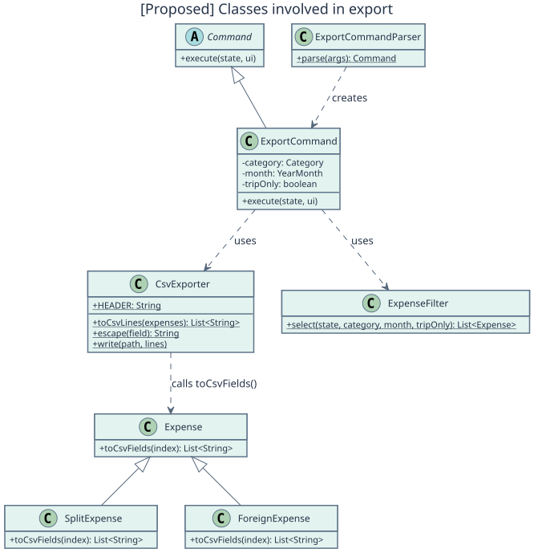

The feature reuses existing parts of the architecture wherever possible:

- **Parsing.** `ExportCommandParser` accepts the same `c/`, `m/` and `trip/`
  arguments as `list` (no sorting), using `ArgumentParser.checkAllowedPrefixes`
  and `getFlag("trip")`. `Parser` gets one new `case "export"` line.
- **Filtering.** `ExportCommand` calls `ExpenseFilter.select(state, category, month,
  tripOnly)`, the same shared helper used by `list`, `split list` and `stats trip/`.
  The export therefore always contains exactly the expenses that `list` shows with
  the same filters, and a missing trip selection produces the same error.
- **Rows.** `Expense` gets a new method `toCsvFields(index)` that returns the values
  of one row. `SplitExpense` and `ForeignExpense` override it to fill their own
  columns, in the same way they already override `toStorageString()`. `CsvExporter`
  never checks the type of an expense, so a new expense type only needs its own
  override.
- **Escaping and writing.** `CsvExporter` is a small helper in the `storage` package.
  `escape(field)` follows the common CSV rule (RFC 4180): a field containing a comma,
  a double quote or a line break is wrapped in double quotes, and each double quote
  inside it is doubled. Descriptions may contain commas and quotes (only `/` and `|`
  are forbidden), so this is required. The rule, in pseudocode:

  ```
  escape(field):
      if field contains ',' or '"' or a line break:
          return '"' + (field with every '"' replaced by '""') + '"'
      return field
  ```

  For example, `Ramen, "large"` becomes `"Ramen, ""large"""`.
  `write(path, lines)` creates the `data` folder
  if needed and writes UTF-8 with a byte-order mark (BOM). An `IOException` is turned
  into a `TripJioException`, so the main loop shows an error and continues.

Amounts are written with `MoneyUtil.toStorageString` (e.g. `1234.50`: no dollar sign
and no thousands separator), so spreadsheets read them as numbers.

The sequence diagram below shows `export m/10-2026 trip/`. Escaping happens inside
`toCsvLines` and is left out of the diagram.

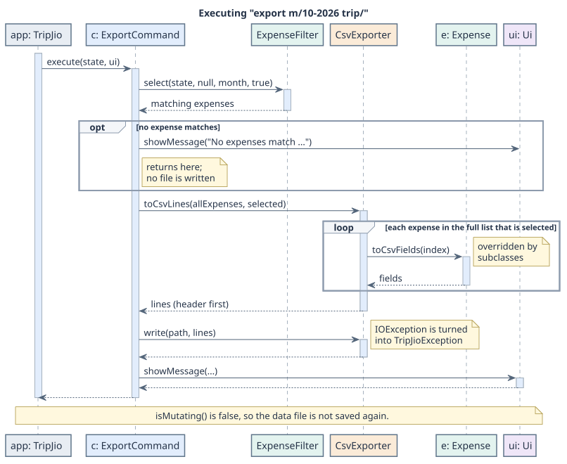

#### Design considerations

Aspect: How each row is built for different expense types.

- Alternative 1 (proposed): Each expense class builds its own row with `toCsvFields`.
  - Pros: Follows the existing `toStorageString` design; no `instanceof` checks;
    a new expense type cannot be forgotten by the exporter.
  - Cons: The model knows about one more output format.
- Alternative 2: `CsvExporter` checks the type of each expense.
  - Pros: All CSV code is in one class.
  - Cons: Needs `instanceof` checks and must be updated for every new type.

Aspect: Date format in the file.

- Alternative 1 (proposed): ISO format `YYYY-MM-DD`.
  - Pros: Spreadsheets recognise it as a date in every region and sort it correctly.
  - Cons: Differs from the `DD-MM-YYYY` format used in commands.
- Alternative 2: `DD-MM-YYYY`, as in the rest of TripJio.
  - Pros: Consistent with the app.
  - Cons: Some spreadsheets read `01-10-2026` as 10 January, depending on the region.

Aspect: Text encoding.

- Alternative 1 (proposed): UTF-8 with a byte-order mark.
  - Pros: Excel then shows descriptions such as `Phở` or `Café` correctly.
  - Cons: A few simple text tools show the mark as an extra character.
- Alternative 2: UTF-8 without a byte-order mark, like `data/tripjio.txt`.
  - Pros: Identical to the data file.
  - Cons: Excel may show non-English characters incorrectly.

#### Planned tests

- `CsvExporterTest`: escaping of commas, double quotes and line breaks; header row;
  empty columns for each expense type.
- `ExportCommandTest`: uses a JUnit `@TempDir`; checks that the rows match `list` with
  the same filters, that no file is written when nothing matches, and that the data
  in `AppState` does not change.

## Maintaining the diagrams

Editable PlantUML sources are in `docs/diagrams`; rendered SVGs are in `docs/images`.
Regenerate them with `java -jar PATH_TO_PLANTUML.jar -tsvg -o ../images docs/diagrams/*.puml`
from the repository root (the output path is relative to the diagram source folder).
The class diagram uses PlantUML's bundled Smetana layout engine, so Graphviz is not required.
Update both source and image when the implementation changes.

## Product scope

### Target user profile

University students who travel, for example on weekend getaways, recess-week
trips, graduation trips or a semester abroad. They:

- have a limited budget and want to control their spending,
- often share expenses with friends (meals, taxis, accommodation),
- prefer typing over mouse interactions and are comfortable with CLI apps,
- prefer a desktop app that keeps their data locally.

### Value proposition

Track travel and daily spending faster than a typical mouse- or app-driven budget
tracker, see your real share of group expenses, record purchases in other currencies,
and stay within a monthly budget, all offline and for free. TripJio is not a booking
platform, bank integration or cloud-synchronised financial account.

## User stories

Priorities: High (must have) `* * *`, Medium (nice to have) `* *`, Low (unlikely to have) `*`.
Stories marked *planned* are not implemented yet.

| Priority | As a ... | I want to ... | So that I can ... |
| --- | --- | --- | --- |
| `* * *` | new user | view command help | learn the accepted input formats |
| `* * *` | traveller | add an expense | track what I purchased |
| `* * *` | traveller | edit an expense | fix details if I entered them wrongly |
| `* * *` | traveller | delete an expense | remove expenses I no longer need |
| `* * *` | traveller | view all expenses | remember what I purchased previously |
| `* * *` | traveller | categorise my expenses | identify where most of my money goes |
| `* * *` | traveller going out as a group | record a shared bill and only my share of it | know how much I actually spent |
| `* * *` | traveller | set a monthly budget | control how much I plan to spend |
| `* * *` | traveller managing my budget | be warned when I am close to or over my budget | avoid overspending |
| `* * *` | traveller | specify my trip start and end dates | evaluate my spending against the time remaining |
| `* *` | traveller | filter expenses by category, month and trip | find specific expenses quickly |
| `* *` | traveller | sort expenses by amount or date | see my biggest or latest purchases first |
| `* *` | traveller abroad | record a purchase in a foreign currency with a rate I choose | see its cost in SGD without internet access |
| `* *` | traveller planning several trips | keep, edit and delete named trips | review the spending of each trip separately |
| `* *` | traveller | view spending statistics by category | check how much I spend each month or trip |
| `* *` | traveller | compare my spending across two months | understand changes in my spending habits |
| `* *` | group traveller | name the participants and bill payer | identify who owes whom |
| `* *` | group traveller | record full or partial repayments | see the remaining net balance |
| `* *` | group traveller | safely edit my own share | correct my spending without partially changing the bill |
| `* *` | traveller | split a foreign bill using an explicit rate | count my share and debts in SGD |
| `*` | student | export my spending (*planned*) | analyse it outside the app |

## Non-functional requirements

The following are design targets and maintenance constraints, not measured benchmarks:

- Run on JDK 25 using a text terminal; require no network for ordinary commands.
- Preserve valid records across restart using UTF-8, including non-ASCII descriptions.
- Reject malformed CLI input with a useful error instead of terminating the session.
- Keep money presentation consistent in SGD to two decimal places; use shared utilities.
- Keep old supported storage formats readable and regression-test migrations.
- Keep domain calculations separate from terminal output and test time-dependent logic
  with explicit dates/clocks where supported. Some parser defaults still use system time.
- Maintain JUnit tests and Checkstyle checks for changes. No latency/load benchmark
  has been established; filtering and full-file saving scale with the amount of data.
- Treat the file as single-user, unencrypted local data. Concurrent writers, access
  control, encryption and cloud backup are not implemented guarantees.

## Glossary

- **CLI:** Command-line interface accepting text commands.
- **SGD:** Singapore dollar; the reporting currency.
- **Global index:** One-based position in the complete expense or trip list.
- **Selected trip:** The explicitly active trip; selection may be absent.
- **Personal share:** The portion of a split bill counted as the user's expense.
- **Full bill:** The entire group purchase, distinct from personal spending.
- **Signed settlement:** Positive money received or negative money paid by the user.
- **Net balance:** Incoming split shares minus outgoing own shares minus signed payments.
- **Rate snapshot:** Conversion rate stored with a foreign expense at creation time.
- **Mutating command:** A command whose successful execution requests saving.
- **Affected month:** Month returned by a command for the post-execution budget check.
- **Legacy storage:** Older `[trip]` data accepted for backward compatibility.
- **Separator line:** The line of dashes printed after every command's response.

## Instructions for manual testing

Use an isolated working directory with `tripjio.jar` and no existing `data` folder.
The fixed expense dates below must be in the past when testing. Each scenario states
its own setup; start with a fresh isolated directory when indexes would otherwise differ.

### Launch, persistence and invalid input

1. Run `java -jar tripjio.jar`, then `help`. Check that available commands are listed.
2. Run `add d/Lunch a/12 c/food dt/01-10-2026`, then `exit` and restart from the same directory.
3. Run `list`. The lunch remains. Run `add d/Bad a/-1`; an error appears and no entry is added.
4. Back up the test data file before experimenting with corrupt records. A malformed
   expense line should produce a skipped-line warning on restart while valid records load.

### Budget boundaries

1. In a fresh instance, run `budget set a/100 m/10-2026`.
2. Add $79 on 01-10-2026: no threshold warning. Add $1 on the same date: 80% warning.
3. Add $20: threshold warning with $0 remaining, not an exceeded warning.
4. Add $1: exceeded warning. `budget status m/10-2026` reports $101 spent and $1 over.

### Split calculations

1. In a fresh instance, run `split d/Dinner a/90 n/3 c/food dt/01-10-2026`.
2. Run `stats m/10-2026`; Food and total spending are $30, not $90.
3. Run `edit 1 a/120`; spending becomes $40. `split list` retains global index 1.
4. `split d/Invalid a/10 n/1` fails without changing the list.

### Trips, filtering and selection

1. Add trips with `trip add n/Japan s/01-10-2026 e/15-10-2026` and
   `trip add n/Korea s/20-10-2026 e/25-10-2026`.
2. Run `trip select 1`, add expenses on 01, 15 and 16 October 2026, then `list trip/`.
   Only the first two dates match; `stats trip/` uses the same inclusive range.
3. Run `trip edit 1 e/16-10-2026`; all three now match. Try an end before the start;
   the edit fails and the original range remains.
4. Run `trip delete 1`. No trip is selected; `stats trip/` reports an error.
5. Select and delete the remaining trip, restart, then `trip list`. No deleted trip
   returns, and unfiltered `list` still shows the expenses.

### Rates and historical amounts

1. In a fresh instance, run `rate set from/JPY to/SGD r/0.01` and
   `add d/Train a/1000 cur/JPY c/transport dt/01-10-2026`.
2. Verify the reported SGD amount is $10. Change the configured rate to `0.02`.
3. The existing expense remains $10, including after restart. A new identical purchase
   uses the new rate and contributes $20. `edit 1 a/2000` uses the original saved rate.

### Statistics and sorting

1. Add differently priced expenses in September and October 2026.
2. Compare `stats m/09-2026`, `stats m/10-2026` and
   `stats compare m/09-2026 m/10-2026`; changes must be second minus first.
3. Reverse the months and confirm change signs reverse; an empty month yields zeros.
4. Run `list sort/amount order/desc`; verify descending personal SGD amounts and
   original global indexes. Reports must not change the stored collection.


### Shared-bill integration and persistence

Use a new isolated folder for each independent scenario; expense dates must be in the past.

1. Set `budget set a/100 m/10-2026`, then create
   `split d/Dinner a/270 n/3 dt/20-10-2026`. Expect a warning with $90 spent,
   not $270. Add an $11 own share to cross the budget and check the exceeded warning.
2. In an empty instance add `split d/Dinner a/100 n/3 p/Alice,Bob dt/01-10-2026`.
   Own share is $33.33; Alice owes $33.34 and Bob $33.33. Record a $10 repayment
   from Alice, restart, then check Alice's $23.34 balance and unchanged spending.
3. Create a custom split with bill $90 and share $40. `edit 1 a/30 d/Changed`
   fails unchanged; `edit 1 a/30 my/10` succeeds. Do this in its own empty folder.
4. Save/reload a deliberately custom $30 share on a $90 three-person bill, then
   change its bill to $120. Own share stays $30, proving the custom flag survived.
5. In a new folder create `split d/Hotel a/100 n/3 p/Alice,Bob paid/Alice cur/EUR rate/1.45 my/45 dt/01-10-2026`.
   Restart: full bill remains SGD 145 and own share/debt SGD 45. Verify the saved
   rate was not applied again. `edit 1 a/150` changes the full SGD bill only.
6. In a disposable file, load a legacy seven-field S record then save/restart.
   It remains a SplitExpense. A malformed extended record warns without preventing
   another valid record from loading. New twelve-field records preserve all metadata.
7. Fully settle a named bill, then delete its split. The payment remains and net
   debt may reverse; this behaviour must agree with the UG. Do not expect settlement
   to change budget totals, and do not expect bill deletion to delete payments.
